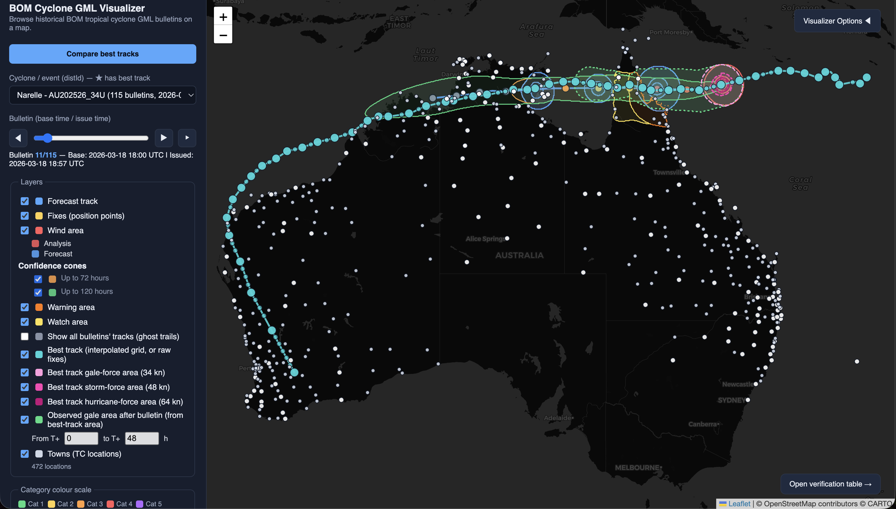
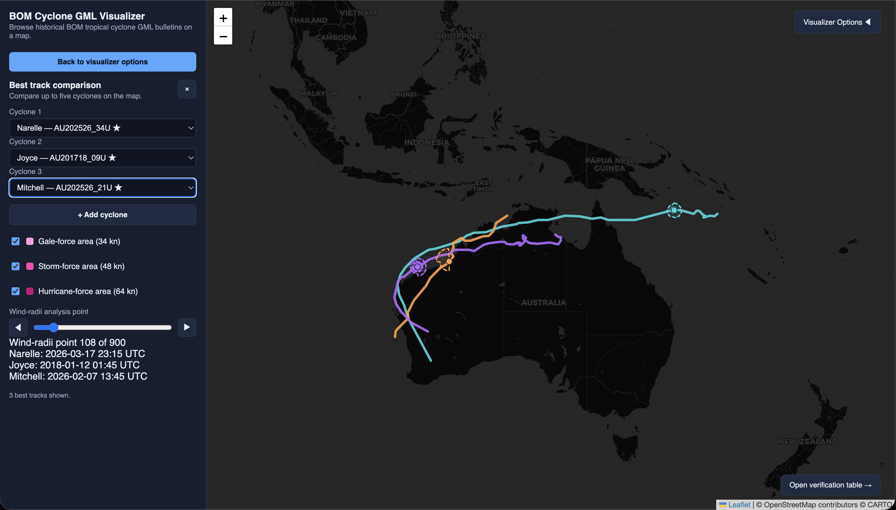
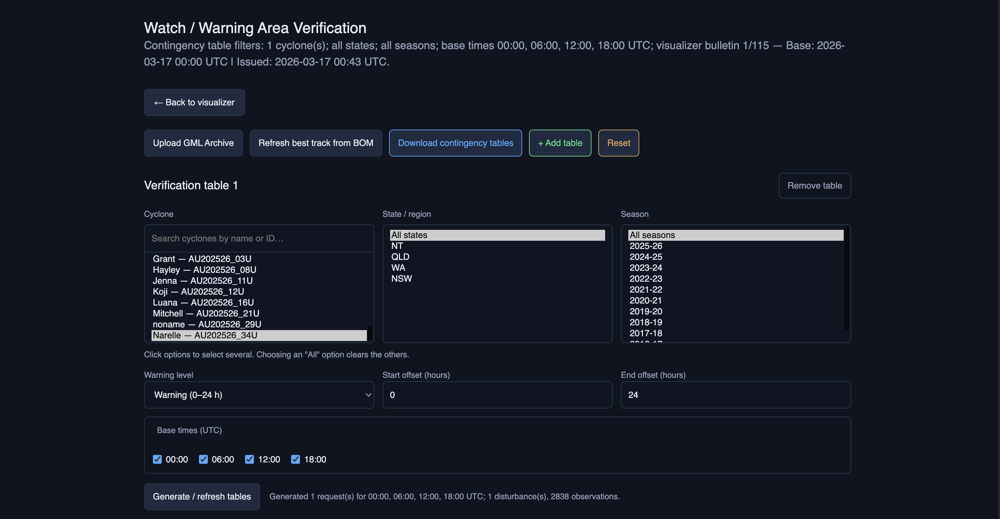
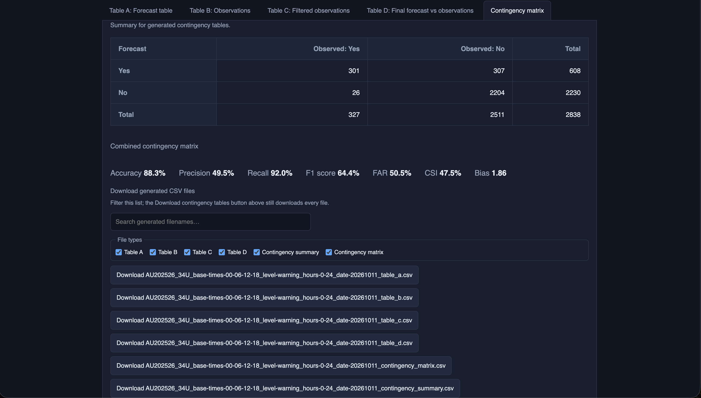

# CITS3200_Group24_Cyclone_Verification

## Group Members

|  Name | Student ID | GitHub Username |
| ------------ | ---------- | --------------- |
| Elliott Naidoo  | 24313893   | Lotto33     |
| Eliza Hutchens | 24230437   | arcococoa |
| Scout Wu | 24729742 | Exusiai101 |
| Siyu Zhu | 24439408 | LZhuSY  |
| Kahlea Aslanis | 23788447 | kahleaa |
| Michael Kartika | 24239793 | mrdudman |

## Scope and deliverables
This prototype verifies the BOM's tropical cyclone watch/warning areas against what actually happened for the 2016/17-2025/26 seasons, using GML data, CSV best-track data, and a list of affected towns.

The prototype will produce data that will help answer the following questions:
1. Did gales occur at the provided locations within the watch/warning areas?
2. Did gales occur at the provided locations that fall outside of the watch/warning areas?
3. How long after a watch/warning was declared did we get gales?
4. What is the probability of experiencing gales if a warning is declared over a location?

The deliverables are:
1. A web app to view the data on a map.
2. A Python codebase that ingests the provided data and outputs verification statistics.
3. A web app for post processing, applies filtering, create verification contingency tables and metric, and output the data tables as a CSV.

## User Guide

Once the app is running, open its home page and choose **Open visualizer** or
**Open verification**. The home page checks backend readiness when either
link is selected; the destination opens in a new tab. The two pages share the
same backend and cyclone data. You can also move between them using **Open
verification table** in the visualizer and **← Back to visualizer** on the
verification page.

### Explore bulletins in the visualizer



1. Choose a **Cyclone / event (distId)** from the sidebar. The option includes
   the cyclone name and ID, bulletin count, and first issue time. A `★` means
   best-track data is available.
2. Use the **Bulletin (base time / issue time)** slider or the previous/next
   buttons to step through bulletins. Select **Play through bulletins** to
   advance automatically; moving the slider or stepping manually stops
   playback. The map normally zooms to the selected bulletin's features.
3. Use the **Layers** checkboxes to focus on the information you need:
   - **Forecast track** and **Fixes (position points)** show the forecast
     track and its position points. Fixes depend on the forecast-track layer.
   - **Wind area**, **Warning area**, and **Watch area** show the respective
     bulletin polygons. Analysis and forecast wind areas use different
     colours.
   - **Confidence cones** has a separate toggle for each forecast extent
     present in the selected cyclone's data.
   - **Show all bulletins' tracks (ghost trails)** adds faint tracks from
     other bulletins for context.
   - **Best track (interpolated grid, or raw fixes)** displays the post-event
     track when available. Its gale-, storm-, and hurricane-force wind areas
     (34, 48, and 64 kn) have independent toggles.
   - **Observed gale area after bulletin** displays best-track gale areas in
     a time window after the selected bulletin. Set **From T+** and **to T+**
     to adjust the window in hours (default 0–48; the supported range is
     0–60 hours).
   - **Towns (TC locations)** shows the reference towns. Hover over a town
     marker for its name and click it for its details.
4. Read **Bulletin details** for the selected bulletin's issue/base times,
   source, expiry and feature counts. Click map features for additional
   details where a popup is available. The category colour scale identifies
   cyclone categories for position fixes.

Use **Visualizer Options** to hide or reopen the sidebar and give the map
more room. **Open verification table** carries the selected cyclone and
bulletin context to the verification page, where the cyclone is preselected
and a table generation is started after the filters load. You can pan and
zoom the map with the mouse or trackpad. The visualizer tries to show the
interpolated best track from the API first and can fall back to raw fixes;
wind-radii areas and comparison areas require available best-track radii.


### Compare best tracks



Select **Compare best tracks** to compare tracks in place of the normal
bulletin controls. Choose cyclones in the selectors; **+ Add cyclone** adds
another selector, up to five. Each best track has its own colour. Choose
which **Gale-force area (34 kn)**, **Storm-force area (48 kn)**, and
**Hurricane-force area (64 kn)** radii to draw. When an area is selected, use
the **Wind-radii analysis point** slider or Earlier/Later buttons to step
through available radii records. A cyclone without radii for the selected
threshold may not show an area. Select **×** or **Back to visualizer options**
to leave comparison mode.

### Upload or refresh data

- Select **Upload GML archive** in the visualizer or **Upload GML Archive**
  on the verification page to submit a `.zip` of GML bulletins. The archive
  must follow the folder layout described in
  [Uploading a GML archive](#uploading-a-gml-archive). The page reports
  processing progress; when it completes, cyclone/filter options reload.
- Select **Refresh best track from BOM** to request the latest best-track
  data from the Bureau. The page reports progress while the data is
  downloaded, validated, imported, and interpolated, then reloads the
  relevant cyclone or filter data. These actions require a running backend
  with network access to BOM. They do not automatically regenerate existing
  verification tables; generate the tables again after refreshing data if
  you want updated results.

### Generate and review verification tables



Each **Verification table** section is an independent analysis. Set its
filters, then select **Generate / refresh tables**:

- **Cyclone**: search by name or ID and select one or more cyclones. If no
  cyclone is selected, select one or more **Season** values to run a
  season-wide analysis. The **State / region** and **Season** filters can be
  combined with cyclone selections.
- **State / region**, **Season**, and **Cyclone** are multi-select lists.
  Click options to toggle them; no Cmd/Ctrl-click is needed. Search narrows
  the cyclone list but keeps already-selected cyclones visible. Choosing an
  “All” option clears other selections in that list; choosing a specific
  option clears “All”.
- Seasons available in the verification page are limited to 2016–17 through
  2025–26. Selecting both cyclones and seasons limits the run to those
  cyclones in the selected seasons; the state/region selection is applied to
  the same run.
- Choose **Warning (0–24 h)** or **Watch (24–48 h)**. This fills the start/end
  offsets with that standard window; you can edit the whole-hour offsets
  yourself as long as the end is later than the start.
- Choose the forecast **Base times (UTC)** to include: 00:00, 06:00, 12:00,
  and/or 18:00. At least one base time is required.

The page reports progress and displays results in tabs: **Table A: Forecast
table**, **Table B: Observations**, **Table C: Filtered observations**,
**Table D: Final forecast vs observations**, and **Contingency matrix**. The
matrix tab shows hits, false alarms, misses, correct negatives, totals, and
the Accuracy, Precision, Recall, F1 score, FAR, CSI, and Bias metrics. If a
selected cyclone/season has no best-track data, a warning explains that
observed gales are assumed absent for that verification; take this into
account when interpreting the scores. In the matrix, a **hit** is a forecast
and an observed gale, a **false alarm** is a forecast without an observed
gale, a **miss** is an observed gale without a forecast, and a **correct
negative** is neither. Accuracy measures all correct classifications;
Precision measures the share of forecast events that were observed; Recall
measures the share of observed events that were forecast. F1 combines
Precision and Recall, FAR is the false-alarm ratio among forecasts, CSI is
the share of hits among hits/false alarms/misses, and Bias compares forecast
event frequency with observed event frequency.

Use **+ Add table** to compare up to five different filter sets on one page.
Each has its own generate button and results. **Remove table** removes an
additional table; the first table cannot be removed. **Reset** removes extra
tables and clears the displayed results and download lists (it does not
delete files already generated by the backend), restoring the first table's
default warning window and base-time selections.
If the page was opened from the visualizer, its saved cyclone/season context
may remain selected after Reset; check the filters before generating again.

### Download results


After generating results, use the **Download generated CSV files** section
below the tables to search filenames, filter by file type, and download an
individual Table A–D, contingency summary, or contingency matrix file. Where
multiple cyclone files are combined for display, combined Table A, B, and C
downloads are also offered. **Download contingency tables** at the top of
the page downloads the generated files for all table instances; it is not
limited by the filename/type filters in an individual download list.

The web pages must be opened from the running app (or another HTTP server),
not directly as `file://` URLs. The verification page, uploads, best-track
refresh, and API-backed best-track features require the FastAPI backend to be
running. For setup and run instructions, see [How to Setup and Run](#how-to-setup-and-run).

## Assumptions

**The list of towns is fixed.** `backend/app/resources/towns.xlsx` is treated as a static reference list that does not change. If it ever does need to change, replace the file in the repository and rebuild everything derived from it (redo all the steps below).

## How to Setup and Run

`backend/` holds a FastAPI service over a relational database of everything in
`data/`: the BoM best track, the code lookup tables from
`data/TC_Database_Structure_Oct2011.pdf`, the GML bulletins, the towns layer,
the interpolated 15-minute track, and the verification (contingency) results
computed from them.

The steps below cover both ways to run the application. Choose **Docker** if
you want the easiest setup, or **without Docker** if you want to run Python
directly on your computer. You do not need Node.js to run the app; Node is
only needed when editing the TypeScript source for the verification page.

### Before you start: get the input data

The large BoM data files are not included in a fresh Git checkout. Ask the
team for the dataset and place it in the repository's `data/` directory with
this layout (folder names are case-sensitive):

```text
data/
├── best_track.csv
├── NT_GMLs/
├── QLD_GMLs/
└── WA_GMLs/
```

The towns workbook is already included at `backend/app/resources/towns.xlsx`. 
Without the BoM files, the server can still start, but the viewer and verification pages will not have
the cyclone dataset to show or score.

NOTE: This stage is entirely optional.It is probably easier to skip it and just upload the zip file of the gmls once through the app's user interface. Additionally, the best track can be retireved anytime automatically by the app by pressing the "Refresh best track from BOM" button in the bottom left of the visualiser or top of left of the verification page. 

### Option A: run with Docker

**Requirements:** Docker Desktop (macOS/Windows), or Docker Engine and the
Compose plugin (Linux). Run these commands from the repository root.

1. Put the input files listed above in `data/`.
2. Build the image and start the app in the background:

   ```bash
   docker compose up --build -d
   ```

   On startup, Docker creates the SQLite database, applies its migrations,
   and starts the API. The repository's `data/` directory is mounted into the
   container, so database and generated files persist on your computer.
3. Build the files used by the map pages:

   ```bash
   docker compose exec app python backend/app/build_gml_dataset.py
   docker compose exec app python backend/app/build_towns_dataset.py
   ```

   The basemap configuration is generated automatically at container
   startup. These dataset-building commands only need to be repeated if the
   source data changes.
4. Load the data into the database and calculate the verification results
   (the full run takes about 12 minutes):

   ```bash
   docker compose exec -w /app/backend app python -m app.cli all
   docker compose exec -w /app/backend app python -m app.cli verify
   ```
5. Open the app in your browser:

   | Page | URL |
   | --- | --- |
   | Home | <http://localhost:8000/> |
   | Cyclone map | <http://localhost:8000/visualize.html> |
   | Verification | <http://localhost:8000/verification.html> |
   | API documentation | <http://localhost:8000/docs> |
   | Health check | <http://localhost:8000/health> |

Stop the app with `docker compose down`; your data and database remain in
`data/`. To follow the logs, run `docker compose logs -f app`. A CARTO API key
is optional; without it, map tiles display CARTO's watermark. If you create a
root `.env` for Docker, set `CARTO_API_KEY=...` and
`DATABASE_URL=sqlite+pysqlite:////app/data/cyclone.db` so the database stays in
the mounted data directory. See [docs/docker.md](docs/docker.md) for more
Docker options and troubleshooting.

### Option B: run without Docker

**Requirements:** Python 3.11 or newer. Run the commands from the repository
root unless a step says otherwise.

1. Put the input files listed in [Before you start](#before-you-start-get-the-input-data)
   in `data/`.
2. Create and activate a virtual environment, then install the backend and
   development dependencies:

   ```bash
   python3 -m venv backend/.venv
   source backend/.venv/bin/activate
   cd backend
   pip install -e ".[dev]"
   ```

   On Windows PowerShell, use `py -3 -m venv backend\.venv` and
   `.\backend\.venv\Scripts\Activate.ps1` instead of the first two lines
   above, then continue with `cd backend` and `pip install`. SQLite is the
   default; you do not need to install or configure a separate database.
3. With the virtual environment still active, return to the repository root
   (`cd ..`) and build the static data used by the map pages:

   ```bash
   python backend/app/build_gml_dataset.py
   python backend/app/build_towns_dataset.py
   python backend/app/build_map_config.py
   ```

   The map-config step is optional. To remove the CARTO watermark, copy
   `.env.example` to `.env` in the repository root and set `CARTO_API_KEY`.
   Without a key, the map still works but its CARTO tiles are watermarked.
   See [Data sources](#data-sources) for details about the generated files.
4. Change back to `backend/` (`cd backend`). Create the database schema,
   ingest the source data, calculate verification results, and check the
   result:

   ```bash
   alembic upgrade head
   python -m app.cli all
   python -m app.cli verify
   ```

   `python -m app.cli all` performs the full ingest and scoring run (about 12
   minutes on a typical local machine). Keep the virtual environment active.
5. Still from `backend/`, start the web server:

   ```bash
   uvicorn app.main:app --reload
   ```

   Open <http://127.0.0.1:8000/> for the home page or
   <http://127.0.0.1:8000/docs> for the API documentation. Use the same URLs
   listed in the Docker option for the map, verification page, and health
   check. Press **Ctrl+C** in the server terminal to stop it.

For more backend commands and database details, see
[backend/README.md](backend/README.md).

**Sharing one database.** If `DATABASE_URL` points at the team's server, you
can run `cli all` without worrying about overwriting anyone else's data:
what you load is merged into what the server already holds, and nothing is
deleted because it is missing from your copy of `data/`. The interpolation and
the verification are then recomputed from the merged server data, so the
result is the same whoever runs it. See
[Re-running against a shared database](backend/README.md#re-running-against-a-shared-database)
for exactly what each step does.

See [backend/README.md](backend/README.md) for the CLI, the endpoints, and --
worth reading before using the data -- the **Data caveats** section, which
records the things about BoM's files that code will otherwise get quietly
wrong: `0` versus `NULL` in the radius columns, missing values written as a
single space, the `99` sentinel, GDA94 rather than WGS84 geometry, and the six
town names that appear twice.

The database is **additive**: the build scripts below still produce the JSON
that `visualize.html` reads for its cyclone list, bulletins and towns. The one
layer that now comes from the database instead is the best-track overlay --
see [Data sources](#data-sources) below.

[docs/architecture.md](docs/architecture.md) explains how the two pipelines,
the backend layers and the viewer's data sources fit together.

## The verification page (`verification.html`)

Unlike the viewers below, this page is generated code: it is written in
TypeScript under `frontend/src/` and compiled to `frontend/assets/verification.js`,
which is what `verification.html` and the FastAPI app actually serve. It
calls `POST /api/v1/contingency-tables/` to build a real contingency table
and skill scores for a cyclone/season/state selection. Rebuild it after
editing the source:

```bash
cd frontend
npm install
npm run build     # or: npm run watch
```

The compiled `frontend/assets/verification.js` is committed, so this step is only
needed when changing `frontend/src/verification.ts`. `npm run build` also
formats the compiled file with Biome.

### Frontend lint and formatting

All frontend code (`frontend/assets/*.js`, `frontend/assets/*.css`, the
`frontend/*.html` pages and `frontend/src/*.ts`) is formatted and linted with [Biome](https://biomejs.dev/)
(tabs, width 4; see `biome.json`). CI fails on any Biome error, or if
`frontend/assets/verification.js` no longer matches what `frontend/src/verification.ts`
compiles to. Warnings are reported but do not fail CI. The compiled
`frontend/assets/verification.js` is formatted but not linted. Before pushing:

```bash
cd frontend
npm install
npm run format          # fix formatting and safe lint issues in place
npm run lint            # same check CI runs; changes nothing
npm run build           # only if you changed verification.ts
```

These files are kept on LF line endings (see `.gitattributes`).

Merging an older branch into the linted `main` produces many formatting
conflicts; see [docs/merging-after-biome.md](docs/merging-after-biome.md) for
the quick way to resolve them.

## Visualizing the BOM cyclone GML data

`data/NT_GMLs`, `data/QLD_GMLs`, `data/WA_GMLs` contain ~3,450 individual BOM
`tcData` GML bulletins. Two self-contained map viewers (no build step, no
framework) browse them interactively — pick a cyclone/event and step or play
through its bulletins to see the track, position fixes,
and wind/forecast/warning/watch areas. Where available, the post-event
**best track** (see below) is overlaid too.

Cyclones are presented in one list rather than filtered by state. If an event
appears in more than one regional BOM dataset, the viewer combines those
bulletins into a single timeline.

- `visualize.html` — built on [Leaflet](https://leafletjs.com/).
- `visualize_ol.html` — the same viewer built on
  [OpenLayers](https://openlayers.org/) instead, with an extra "data-retention
  check" panel that shows exactly which GML fields survived into the JSON
  for the bulletin on screen, plus the raw JSON itself.

Both read the identical dataset produced in step 1, so they stay in sync
automatically.

### Data sources

`visualize.html` never reads GML or CSV directly. Almost everything it draws
is pre-built JSON under `data/`, which the build scripts below produce from
the raw files:

| Fetched by the page                                                 | Built by                             | Raw source                                                               |
| ------------------------------------------------------------------- | ------------------------------------ | ------------------------------------------------------------------------ |
| `data/index.json` (cyclone list)                                    | `backend/app/build_gml_dataset.py`   | `data/NT_GMLs/`, `data/QLD_GMLs/`, `data/WA_GMLs/` (`productfile.*.gml`) |
| `data/<REGION>/<distId>.json` (bulletins: tracks, fixes, areas)     | `backend/app/build_gml_dataset.py`   | same GML folders; only cyclones with at least one watch/warning area     |
| `data/best_track/<distId>.json` (best-track overlay, fallback only) | `backend/app/build_gml_dataset.py`   | `data/best_track.csv` (BoM IDCKMSTM0S), matched on `DISTURBANCE_ID`      |
| `data/towns.json` (Towns layer)                                     | `backend/app/build_towns_dataset.py` | `TC Locations` sheet of `backend/app/resources/towns.xlsx`                |
| `data/map_config.json` (basemap tile URL)                           | `backend/app/build_map_config.py`    | `CARTO_API_KEY` in `.env`                                                |

The one exception is the best-track overlay. The verification is scored on
the interpolated 15-minute grid, so the page asks
`/api/v1/disturbances/<distId>/interpolated-track` for it first and only falls
back to the raw 6-hourly `data/best_track/<distId>.json` when that route is
unavailable -- served from `python -m http.server` rather than the FastAPI
app, or before `python -m app.cli interpolate` has produced a run. The info
panel names whichever one is on screen.

Not used by the viewer: `data/OTCR_alldata_final_external.csv`,
`data/processed/*.csv`, `data/contingency_tables/*.csv` and `data/geojson/`
(built alongside the viewer JSON, but consumed by `gen_cont_tables.py`).

### 1. Build the dataset (one-off, or whenever `data/` changes)

The GML files are parsed once into compact per-cyclone JSON files so the
browser doesn't have to parse thousands of raw XML files. The build script
lives at `backend/app/build_gml_dataset.py` — **run it from the repository
root**, not from inside `backend/app/`, since its `--data-dir`/`--out-dir`
defaults are plain relative paths resolved against your current working
directory:

```bash
python backend/app/build_gml_dataset.py
```

> `backend/app/gml_to_geojson.py` must stay alongside `build_gml_dataset.py`
> in the same folder — `build_gml_dataset.py` imports it directly
> (`import gml_to_geojson`), and Python resolves that import against the
> invoked script's own directory, not your current working directory, so
> this works correctly regardless of where you run the command from as long
> as the two files are together.

This writes `data/index.json` plus one JSON file per cyclone under
`data/<REGION>/<distId>.json`, along with the per-bulletin GeoJSON that
`backend/app/gen_cont_tables.py` consumes under `data/geojson/<distId>/`.
Generated output under `data/` besides the source GML folders is
git-ignored — regenerate it locally rather than committing it.

It also parses `data/best_track.csv` — BOM's **best track** database (the
track as re-analysed after the event, distinct from the
`Observed`/`Forecast` tracks in the GML bulletins) — and writes one
`data/best_track/<distId>.json` per disturbance the CSV covers, matched to
GML cyclones by `distId`/`DISTURBANCE_ID`. Not every cyclone has a match:
best track is only published for seasons BOM has fully reanalysed, so recent
cyclones typically won't have one yet. Cyclones with a match are flagged
`"hasBestTrack": true` in `data/index.json`. Pass `--best-track-csv ''` to
skip this step, or `--best-track-csv <path>` to point at a different CSV.

### 2. Build the towns layer and the basemap config

The viewers overlay BOM's tropical-cyclone locations (the **Towns** layer) so
you can see where a cyclone sits relative to populated places. They come from
the packaged `TC Locations` sheet of `backend/app/resources/towns.xlsx` — the same sheet
`gen_cont_tables.py` scores against, so the map and the contingency tables
refer to the same set of locations. As with the GML data, the browser can't
read an xlsx, so parse it once into JSON (**from the repository root**):

```bash
python backend/app/build_towns_dataset.py
```

This writes `data/towns.json` (~470 locations, each with name, state,
lat/lon, town group, coastal order, and major/island flags). Rows with a
missing name or missing/invalid coordinates are skipped — the sheet has
formatted-but-empty trailing rows, so a skipped count in the hundreds is
expected, not an error.

CARTO stamps an "API KEY REQUIRED" watermark across every basemap tile it
serves without an API key. Free-tier keys are available at
[carto.com/basemaps/apikey](https://carto.com/basemaps/apikey/). Copy the
example env file, paste your key into it, and generate the config the page
reads:

```bash
cp .env.example .env      # then set CARTO_API_KEY=... in .env
python backend/app/build_map_config.py
```

This writes `data/map_config.json` with the tile URL. Both `.env` and `data/`
are git-ignored, so the key never lands in the repository. Both steps are
optional: without `data/towns.json` the Towns layer shows a hint in the
sidebar instead of dots, and without `data/map_config.json` the map falls
back to the keyless (watermarked) basemap. The rest of the viewer works
either way.

### 3. Serve the page

Browsers block `fetch()` of local files opened via `file://`, so the page has
to be served over HTTP. The FastAPI backend serves `visualize.html` and the
`data/` folder alongside the API:

```bash
cd backend
uvicorn app.main:app --reload
```

Then open [http://localhost:8000/visualize.html](http://localhost:8000/visualize.html)
(`/` redirects there). The page still reads the JSON built in steps 1 and 2
for its cyclone list, bulletins and towns, so those steps are still required.
Only the best-track overlay comes from the database, and it falls back to
`data/best_track/<distId>.json` when the API cannot answer.

The pages live in `frontend/` (HTML in `frontend/`, CSS/JS in
`frontend/assets/`) while `data/` stays at the repository root, so the FastAPI
app, which mounts both at the URLs the pages expect, is the supported way to
serve them. A plain static server pointed at the root will not find `data/`.

## Uploading a GML archive

New GML bulletins can be added via the "Upload GML archive" button on both the visualizer and verification page. The archive must be a `.zip` containing exactly three folders, one per state, with `NT`, `QLD` or `WA` (in capitals) in each of the folder names (e.g. `WA_GMLs`). They must be at the top level of the zip, not inside another folder. When unzipped, it should look like this:

```
archive.zip
├── NT_GMLs/
├── QLD_GMLs/
└── WA_GMLs/
```

### Data retention

`build_gml_dataset.py` captures every field present in the source GML:
`distId`, `distName`, `fcastTime`, `issueTime`, `expiryHrs`, `source`
filename, the `gml:boundedBy` envelope, every `tcTrack` (coords, trackType,
start/end time), every `tcFix` (coord, fixType, fixTime, symbol, category,
timeOffset), and every `tcWindArea` / `tcForecastArea` / `tcWarningArea` /
`tcWatchArea` (all polygon rings including holes, areaType, extent,
windType, marineType, fixType, fixTime). Nothing in the GML schema is
dropped except the fixed `xsi:schemaLocation`/namespace declarations, which
carry no per-bulletin data. `visualize_ol.html`'s "Data-retention check"
panel verifies this live, per bulletin, against the raw JSON.

Best track (`data/best_track/<distId>.json`) captures every point BOM's CSV
records for that disturbance: `time`, `coord` (`[lon, lat]`), `pressure`
(`CENTRAL_PRES`), and `windSpeed` (`MAX_WIND_SPD`), sorted by time. It's
per-cyclone, not per-bulletin — one fixed post-event track, independent of
which bulletin is currently on screen.

### 4. Generate contingency tables

`backend/app/gen_cont_tables.py` builds Tables A–D and the hit/miss/false
alarm/correct-negative contingency summary for a single disturbance ID,
comparing forecast watch/warning areas (from step 1's GeoJSON output) against
observed gales (from the best-track CSV). Unlike `build_gml_dataset.py`, its
data paths are resolved from `__file__` rather than the current working
directory, so it can be run from anywhere — the repo root or elsewhere:

```bash
python backend/app/gen_cont_tables.py AU202526_34U
```

Optional flags:

```bash
python backend/app/gen_cont_tables.py AU202526_34U \
  --output-dir data/contingency_tables \
  --x-hours 0 \
  --y-hours 24
```

#### Filter results by state or season

To generate statistics for one Australian state, use `--state` with the
state value stored in `backend/app/resources/towns.xlsx`:

```bash
python backend/app/gen_cont_tables.py AU202526_34U --state WA
```

The state filter is applied to the `State` column from the `TC Locations`
sheet in `backend/app/resources/towns.xlsx` before any tables are generated. Only matching
locations are passed through Tables A, B, C, and D. `State` is used for
filtering but is not included as a column in Table A or Table D. The filter is
not inferred from the cyclone's path or from the GML source region.

To generate a combined contingency table for every disturbance in a
Jul–Jun cyclone season, use `--season` without a disturbance ID:

```bash
python backend/app/gen_cont_tables.py --season 2025-26
```

The season is derived from each forecast base time (`fcastTime`): July to
December starts the named season, while January to June belongs to the
previous year's season. For example, `2025-26` covers July 2025 through June 2026.

The filters can be combined. This generates all disturbances in the season,
then reports the final contingency statistics for one state:

```bash
python backend/app/gen_cont_tables.py --season 2025-26 --state WA
```

If a disturbance ID is supplied along with `--season`, the explicitly supplied
disturbance ID is used; use `--season` on its own to select a whole season.

- `disturbance_id` (optional when `--season` is supplied) — one or more BOM
  disturbance IDs, e.g. `AU202526_34U`. If omitted, `--season` must be used
  to select all disturbances in that Jul–Jun season.
- `--output-dir` (default `data/contingency_tables`) — where the generated
  CSVs are written.
- `--state` — generate Tables A-D using only locations whose `State` column in
  the `TC Locations` sheet matches the supplied value (for example, `WA`).
- `--season` — select all disturbances whose forecast base times fall in a
  Jul–Jun season (for example, `2025-26`).
- `--coastal-buffer-km` (default `6.0`) — distance from a watch/warning edge
  within which a coastal location counts as covered for eligible bulletins.
- `--coastal-buffer-cutoff` (default `2025-06-01`) — date from which the
  coastal buffer is disabled.
- `--relevance-km` (default `300.0`) — maximum distance from a watch/warning
  area for a location to be included in Table A.
- `--x-hours` / `--y-hours` (default `0` / `24`) — the window, relative to
  each forecast base time, in which an observed gale counts as a "hit"
  against that forecast.

This writes dated, filter-aware CSVs under `--output-dir`. For example, a WA
run generated on 11 September 2026 produces names such as
`AU202526_34U_state-WA_date-20260911_table_a.csv` through
`_table_d.csv`, plus the corresponding contingency matrix and summary files.
Season-selected combined runs include the season too, for example
`combined_season-2025-26_state-WA_date-20260911_table_d.csv`. If no state or
season filter is applied, those filter components are omitted. The run date is
the date on which the CSVs are generated.

All times are UTC. The `Time` (Table B) and `Base time` (Tables A, C, D)
columns are written with an explicit offset, e.g. `2025-11-18 00:30:00+00:00`.
The inputs are UTC too: best-track `TM` per BoM's database specification, and
every GML time carries a `Z` suffix. CSVs generated before the offset was added
have no suffix; they are still read as UTC.

Progress plus the final contingency stats and matrix are also printed to the
console as the script runs.

Requires step 1 (`build_gml_dataset.py`) to have already been run — it reads
the `data/geojson/<distId>/` files that step produces — plus the packaged `TC Locations`
sheet in `backend/app/resources/towns.xlsx` and a best-track CSV. If
`data/processed/best_track_interpolated.csv` exists, it is preferred because
it already contains the significant-cyclone filtering and interpolation. If
it does not exist, the script falls back to `data/best_track.csv` and performs
the interpolation locally.

If you only need one of Tables A–D rather than the full run, the individual
`generate_table_a()` / `generate_table_b()` / `generate_table_c()` /
`generate_table_d()` functions can be imported and called directly; Table C
also accepts an already-computed Table B via its `table_b=` parameter to
avoid rebuilding it (Table B is the most expensive of the four to compute).

### Notes

- `backend/app/gml_to_geojson.py` converts a single GML bulletin's features
  into a standalone GeoJSON `FeatureCollection`; `build_gml_dataset.py`
  imports and reuses it to write the per-bulletin GeoJSON under
  `data/geojson/` that `gen_cont_tables.py` consumes, so there is one shared
  implementation rather than two that could drift apart.
- `python backend/app/build_gml_dataset.py --data-dir data --out-dir data`
  accepts custom input/output paths if needed (both shown here at their
  defaults).
- In the viewers, GML `tcTrack` styling distinguishes the two `trackType`
  values: **Forecast** is solid, **Observed** is dashed. The best-track
  overlay (teal, toggleable via the "Best track (interpolated grid, or raw
  fixes)" layer) is a separate line, not a `trackType` value — cyclones with
  a best track are marked ★ in the cyclone dropdown. It prefers the
  interpolated 15-minute grid from the API and falls back to the 6-hourly CSV
  data described above.
- `tcWindArea` polygons distinguish their `fixType`: **Current** areas are
  red and **Forecast** areas are blue.
- Town dots are drawn once at startup into their own Leaflet pane above the
  cyclone polygons, and are deliberately excluded from the zoom-to-cyclone
  bounds calculation — selecting a cyclone still frames that cyclone, not all
  of Australia. Hover a dot for its name, click it for state, coordinates,
  town group, coastal order, and major/island flags. Major towns are drawn
  slightly larger and white.
- `python backend/app/build_map_config.py --style light_all` switches the
  basemap to CARTO's light style (`dark_all`, `light_all` and
  `rastertiles/voyager` are supported); `--env-file` points at a different
  env file. `CARTO_API_KEY` set in the environment takes precedence over
  `.env`, so CI can inject a key without writing one to disk.
