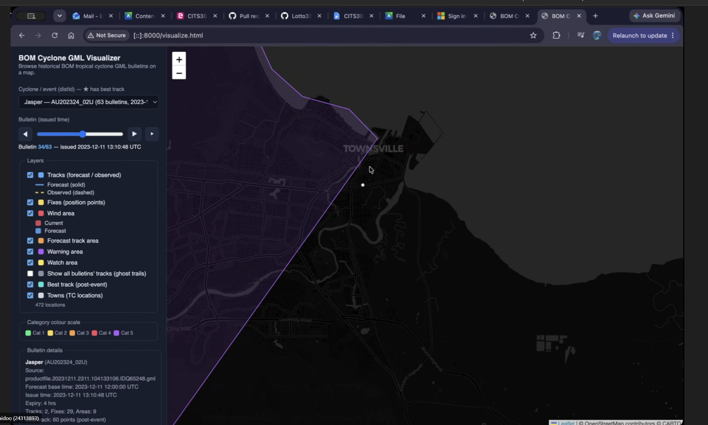
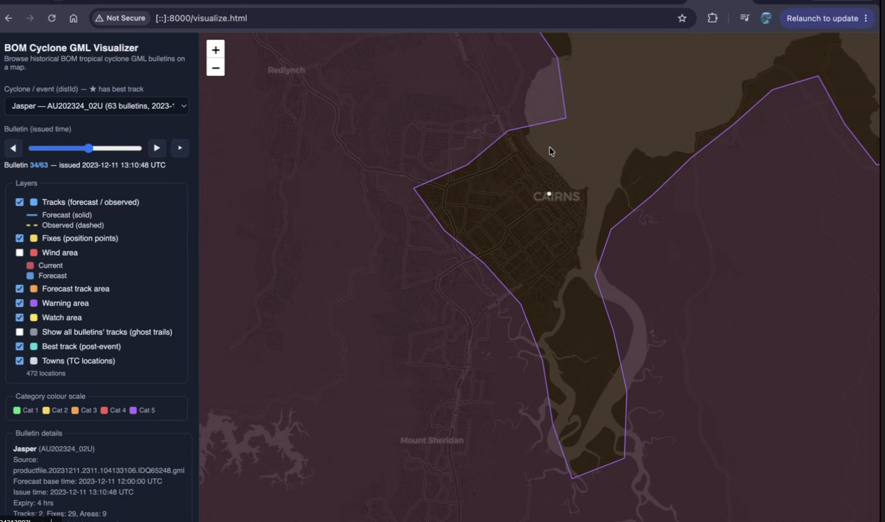

Contengency table in a saperate page.
display multiple cyclones?

The period where the observations came from.

Anything else to detect:

- probibilities of detection
- false alarm ratio.

Buffer point in the email?

assume towns is in.

distance from towns to polygons. if dist < buffer consider its in. if not consider its out.

Carins in the watch and warning area
